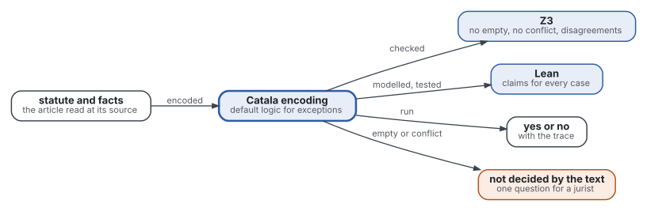
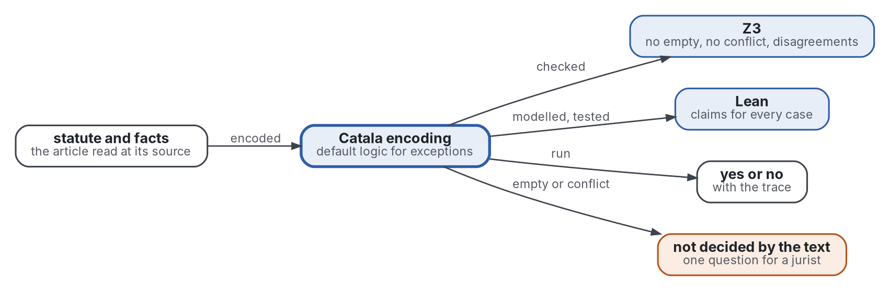

# Law oracle

A statute written as code that a program checks, so that a question about a case gets a verdict with its trace, and a
question the text does not settle is said to be one. The field calls this **rules as code**, and applying a statute to
facts **statutory reasoning**; "oracle" is meant in the testing sense, an answer trusted because it was checked.

> **Status (2026-11-16):** the literature review is done, as a first pass of 46 sources, and names two baselines. Three
> decisions are taken. B1 ran as it is: 189 of 189 tests of Catala's examples pass ([runs](evidence/baseline-runs.md)).
> The first encoding of our own is [retractation/](retractation/README.md), the right of withdrawal from a distance
> sale: 35 tests pass; the proof backend has not run on it.
>
> **How it is made:** with Claude, an AI assistant by Anthropic, under the maintainer's direction, the way
> reader-ergonomics was made. Every figure in the review was read in an abstract or a summary and is marked so.
> Corrections are welcome as issues. Nothing here is legal advice.

## What a verdict is

Graphviz source

- **Three values** ([0002](decisions/0002-a-verdict-has-three-values.md)): yes, no, or not decided by the text. The
  third carries what made it so and the question that would close it.
- **Three layers** ([0001](decisions/0001-catala-for-the-statute-z3-for-bounded-checks-lean-for-theorems.md)): Catala
  for the statute, Z3 for what a bounded check settles, Lean for claims over every case.

## Where it sits

- **Its review is in the shapes of [reader-ergonomics-review](https://github.com/Tewf/reader-ergonomics-review)**, v0.1.1:
  [evidence/statutes-as-code](evidence/statutes-as-code/README.md).
- **A Lean claim takes the claim shape of [reader-ergonomics-blueprint](https://github.com/Tewf/reader-ergonomics-blueprint)**,
  whose own review of autoformalization left law out; this repository picks law up.
- **Its decisions take the record shape of [reader-ergonomics-software-design](https://github.com/Tewf/reader-ergonomics-software-design)**, v1.1.0.
- **[ai-augmented-law-oracle](https://github.com/Tewf/ai-augmented-law-oracle)** is its sibling: a model translates
  statutes into code and verdicts into words, judged by this repository's checks.
- **It obeys [reader-ergonomics](https://github.com/Tewf/reader-ergonomics/blob/65e42472e2d4cbfd994c2a86e95a47e5dc7301ca/standard.md)** (v1.24.2) and runs its checks in CI.

## Scope

| | What | Why |
|---|---|---|
| in | provisions that compute or decide from facts: benefits, taxes, thresholds, deadlines | there the verdict is computable once the facts are fixed |
| in | the third value, for what the text leaves open | open texture is real and measured; hiding it is the failure to avoid |
| in | claims over every case, proved in Lean | what a test cannot show |
| out | finding the facts of a case | a question of evidence, not of the rule |
| out | legal advice | the oracle states what a text computes, never what to do |
| out | the model's translation | [ai-augmented-law-oracle](https://github.com/Tewf/ai-augmented-law-oracle) |

## Baselines

- **B1:** Catala on its French encodings ([CatalaLang/catala-examples](https://github.com/CatalaLang/catala-examples)),
  with its tests and its Z3 proof backend.
- **B2**, for the sibling: DeonticBench's symbolic setting ([guangyaodou/DeonticBench](https://github.com/guangyaodou/DeonticBench)).
- How each is measured: [baseline](evidence/statutes-as-code/baseline.md); the record: [0003](decisions/0003-measure-against-catala-and-deonticbench.md).

## Next: what makes its claims testable

Three deliverables, each a measure another project can rely on. None is started.

1. **The proof backend on a real encoding.** Catala is built with its Z3 bindings and run on the family-allowances
   encoding of B1. Each empty error (a case no rule decides) and conflict error (a case two rules decide) is shown as a
   case. This measures whether completeness and consistency checks find anything real.
2. **A disagreement enumerator.** Given two Catala encodings of one provision, Z3 lists the input cases where their
   decisions differ (the measure of Vernie 2026). It is the instrument that scores a second encoding against a reference,
   which the sibling [ai-augmented-law-oracle](https://github.com/Tewf/ai-augmented-law-oracle) needs.
3. **The first encoding of our own,** of a provision whose reference encoding exists, so that it can be compared by
   decisions from its first day.

## Layout

- [retractation/](retractation/README.md): the right of withdrawal from a distance sale, in Catala, with its tests.
- [evidence/](evidence/README.md): the review, its search log, the bibliography, and the [baseline runs](evidence/baseline-runs.md).
- [decisions/](decisions/README.md): the records of this repository's choices.
- [checks/](checks/config.toml): the configuration of the standard's checks.

## Licence

Code under the [Apache License 2.0](LICENSE); prose under [CC BY 4.0](LICENSES/CC-BY-4.0.txt).
